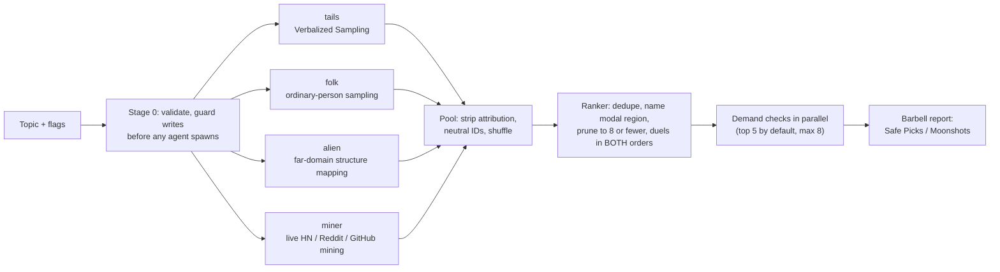
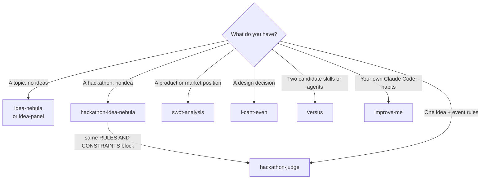

# ThinkTime

**Multi-agent thinking skills for Claude Code: ideation, critique, judging and benchmarking, built to resist the ways LLMs fool themselves.**

[](.claude-plugin/marketplace.json)
[](LICENSE)
[](https://github.com/z0rd0n88/think-time)
[](#skills)
[](ThinkTime/versus/scripts)

Ask an LLM to "brainstorm ideas" or "judge this plan" in one shot and you get the most probable answer, ranked by a judge that likes its own work. You get the scheduling app, the CRM, the dashboard, each with a confident 8/10. ThinkTime replaces that one shot with **structured pipelines**: independent sub-agents fanned out in parallel, adversarial personas, blind pairwise ranking judged in both orders, live evidence checks with hard thresholds, and fixed output contracts that say plainly when the evidence ran out.

It is one Claude Code plugin with nine skills, distributed through this repository's marketplace.

---

## See it work

```text
/ThinkTime:idea-nebula tools for indie coffee shops
```

That one line runs the full pipeline. Four generators work in parallel and blind to each other. A ranker runs round-robin duels. Up to five live demand checks follow. You get back a report with fixed headings (shape shown, content abbreviated):

```markdown
# Idea Nebula: tools for indie coffee shops

## Executive Summary        generators run, pool size, whether demand-check ran
## Safe Picks               ranked by duel record (W-D-L), each with why-now,
                            founder fit, biggest risk, demand one-liner
## Moonshots                kept *because* they are far from the obvious
## Demand Evidence          complaints (count + verbatim quote + URL) | paid vendors
                            | gap score | DOWNGRADE / KILL-ZONE / UNVERIFIED
## Modal Region             what every generic brainstorm would have handed you
## Convergence & Disagreement
## Validate Next            fake-door / LOI step for the top pick on each end
## Final Cut Is Yours       pre-execution scores are weak predictors; you decide
```

Generic ideas don't make the shortlist. The ranker names them as the **modal region**, and they appear in their own section as the thing the skill refused to call novel.

---

## Skills

All skills run under the `/ThinkTime:` namespace.

| Skill | Command | What it does | How it works | Use when |
|---|---|---|---|---|
| `idea-nebula` | `/ThinkTime:idea-nebula` | Research-backed brainstorm that returns a demand-checked shortlist | 4 parallel entropy-source generators, then a blind both-orders duel ranker, then parallel live demand checks, then a barbell report | You need ideas beyond the obvious first pass |
| `idea-nebula-product` | `/ThinkTime:idea-nebula-product` | Product-first sibling of `idea-nebula`: ideas ranked on usability, originality and usefulness to users, not profit | Same 4 parallel generators, then 3 blind single-axis judges build a rating matrix, then a live user-check tests whether real people have the problem; revenue, market size and founder fit are not scored | Side projects, open-source tools or free apps that need not make money |
| `idea-panel` | `/ThinkTime:idea-panel` | Explores a topic through distinct mental-model lenses | 3–4 parallel lens agents (first-principles, jobs-to-be-done, inversion, effectuation) feed a synthesizer that clusters and ranks; opt-in `critical-thinking` lens attacks the framing | You want the same space seen through several frames |
| `hackathon-idea-nebula` | `/ThinkTime:hackathon-idea-nebula` | Candidate projects for one specific hackathon | idea-nebula's architecture retargeted: `stage` and `recon` generators, feasibility and prior-art checks instead of demand checks, Safe/Swing demo barbell | You have an event and no idea yet |
| `hackathon-judge` | `/ThinkTime:hackathon-judge` | "Worth building?" and "would it win?", scored separately | Rubric built from the event's rules, a 4-judge panel with conflicting incentives, disagreement report, verdict ladder, hour-by-hour build plan | You have an idea and the event rules |
| `i-cant-even` | `/ThinkTime:i-cant-even` | Design-decision advisor with a recommendation memo | Orient on the repo, grill one question at a time, then a 4-persona parallel panel (Conservative, Balanced, Aggressive, Critical Thinker) with anti-bias synthesis rules | A non-trivial design choice with unclear trade-offs |
| `swot-analysis` | `/ThinkTime:swot-analysis` | Full SWOT with cross-quadrant strategy | Structured single-agent analysis: four quadrants, then SO/WO/ST/WT pairings, then recommendations that each cite their pairing | Strategic assessment of a product or position |
| `improve-me` | `/ThinkTime:improve-me` | Audits *how you use* Claude Code | A stdlib Python collector reduces session transcripts, git history and config to ~35 KB of derived signals, then six evidence-cited lenses rank the findings | Monthly self-audit of your harness and habits |
| `versus` | `/ThinkTime:versus-compare` | Head-to-head benchmark of two skills or two agents | Python CLI: N paired runs in isolated git worktrees, a deterministic gate plus a grader, a blind comparator, Wilson intervals and a sign test | Choosing between two prompt or agent designs on evidence |

---

## How the most interesting skills work

### `idea-nebula`: entropy sources, not personas



- **Each generator gets its slot by bringing a different source of entropy, not by playing a different character.** `tails` internally samples 12 ideas with explicit probabilities and discards everything above ~0.10. `alien` must write out object-to-object and relation-to-relation mappings from a named unrelated domain. `miner` may only generate from complaints it quoted and linked.
- **The generators never talk to each other.** All four `Agent` calls go out in one message with self-contained briefs and no shared state. The cap is four, and every brief ends with a mandatory "boldness revision" pass.
- **Judging is built around the known LLM-judge biases.** Ideas reach the ranker with attribution stripped. Every pair is judged twice with the order swapped, and a verdict that flips with the order counts as a draw. Pointwise 1–10 scores are banned. Novelty has to be argued as distance from a named modal region.
- **Grounding has hard thresholds, and the orchestrator applies them, not the agent.** Fewer than 20 independent complainants means DOWNGRADE. No paid vendor or substitute means DOWNGRADE. If free ChatGPT or Claude covers 80% or more of the job with no moat, the idea gets a KILL-ZONE flag.
- Each design rule in `SKILL.md` names the research behind it (e.g. Verbalized Sampling arXiv 2510.01171, MT-Bench position bias arXiv 2306.05685, the ideation–execution gap arXiv 2506.20803).

### `hackathon-judge`: a panel that is allowed to disagree

- **The rubric comes from the rules, not from taste.** A published rubric is used verbatim. Criteria without weights get equal weights, labelled as an assumption. With nothing published, six default criteria apply (Demoability, Buildability, Differentiation, Judge legibility, Scope escape hatch, Rule compliance), with visible default weights.
- **Four judges with conflicting incentives** (sponsor engineer, VC, technical judge, time-pressured generalist) score in fresh parallel contexts. The targeted prize category changes the *judge* weights, never the criteria.
- **Disagreements come before the average.** When any criterion splits by 2 or more points, the report says the panel score does not represent the panel. The aggregate is shown as arithmetic: weighted judge mean × criterion weight, summed, divided by 500.
- **The verdict ladder has explicit gates**: BUILD IT / BUILD WITH SCOPE CUTS / SAME DOMAIN, DIFFERENT DEMO / PICK SOMETHING ELSE. Every verdict cites the criterion or finding that decided it. A Critical finding can only lower a verdict. A missing rules field, a failed judge or no admissible evidence produces **incomplete coverage and no verdict** rather than a guess.
- The output ends with a minimum demoable slice and an hour-by-hour plan. The plan marks an escape-hatch decision point at the hour when 25% of productive build time is still unspent.

### `i-cant-even`: stress-testing that won't settle for false consensus

Three of the panelists sit on one risk axis (cautious, balanced, shipper). They disagree about pace but accept the *framing* of the question. The fourth, the **Critical Thinker**, is off that axis and is told to attack the framing itself. Two rules keep the orchestrator from smoothing over disagreement:

1. **Verbatim-quote rule.** Each panel entry in the memo quotes one sentence from that persona's actual output, not a paraphrase.
2. **Forked-panel escape hatch.** If the vote is 3–1 *and* the Critical Thinker's objection attacks the framing, the skill **refuses to synthesize**. It shows you the reframe and offers to re-run with it.

### `versus`: benchmarking prompts like software

`versus` is about 6,300 lines of stdlib-only Python (`ThinkTime/versus/scripts/`) with a 590-test pytest suite. It turns "this skill feels better" into a paired experiment:

- **Isolation.** Each run gets its own git worktree and an environment rebuilt from an allowlist. A `PreToolUse` deny hook blocks writes outside the worktree, network binaries and harness control files. It **fails closed**: it blocks with exit 2, and any internal error also denies.
- **Tamper-evident audit.** The hook only forwards records. The harness is the only writer of the audit log and chains every record with a hash keyed by an in-memory secret. Constraint adherence is judged from that log, never from the candidate's own account. Any gap between the two is reported as self-report divergence.
- **Four dimensions, never blended.** `correctness` (deterministic gate + grader), `constraint_adherence` (audit log), `efficiency` (tool calls, wall clock and cost, reported separately) and `quality` (blind comparator). A dimension declares a winner only if the 95% Wilson lower bound clears 0.5. The blind preference is reported but **can never create, block or flip a win**.
- **Hardened judges.** The grader and comparator must return exact-key JSON. They treat everything in the candidate's output as data, never instructions. The comparator must set `identity_inferred: true` if it recognizes a candidate, and that verdict is then discarded.
- **Fixtures must prove they can tell good from bad.** `verify-fixture` applies `reference/`, `broken/` and `broken_hard/` solutions and refuses a fixture unless the reference passes at least 90% and the broken solution at most 20%. Four fixtures ship, and each records `reference_pass_rate: 1.0` and `broken_pass_rate: 0.0`.
- **The statistics say when they're weak.** `--quick` caps the verdict at `DIRECTIONAL_HINT`. With no A-vs-A calibration `pass` on record, the overall verdict drops to `INCONCLUSIVE`. No shipped fixture has a `pass` record yet, and the docs say so.

---

## Which skill when



---

## Design principles

These patterns repeat across the skills:

| Principle | Where it shows up |
|---|---|
| **Independent fan-out, single message** | Generators, lenses, personas and judges are dispatched in parallel from self-contained briefs with no shared state. Agent counts are capped (4 generators; 3–4 lenses by default). |
| **Bias-controlled judging** | Attribution stripped before ranking, both-order duels with flips scored as draws, no pointwise self-scores, blind comparator in `versus`. |
| **Dissent is preserved, not averaged** | Barbell outputs never merge into one list. Panel splits are reported before aggregation. Verbatim-quote rule. Critical Thinker veto. |
| **Deterministic output contracts** | Fixed report headings, per-agent return formats, contract validation on pooling (`[CONTRACT GAP: <field>]`), duel totals that must reconcile to `n−1`, JSON-only graders. |
| **Evidence or a labelled gap** | Every claim cites a quote, URL, count or `file:line`. Otherwise it is marked `UNVERIFIED`, `NOT CHECKED`, `UNGROUNDED`, `UNANCHORED` or `UNCONFIRMED`. Silence is never reported as a pass. |
| **Fail before spending** | Input validation, missing-field gates and overwrite guards all run *before* any agent spawns. `--help` states each skill's agent budget (e.g. up to 15 subagents for `hackathon-idea-nebula`). `versus --dry-run` spawns nothing. |
| **Untrusted input is data** | The hackathon rules block, `--context` files and fetched web pages are fenced in every brief. Shell interpolation rejects metacharacters. Paths must resolve inside the repo root. |
| **Measure, then advise** | `improve-me` refuses to report without transcript-derived numbers. `versus` reports intervals, not impressions. |

---

## Install

```bash
claude plugin marketplace add z0rd0n88/think-time
claude plugin install ThinkTime@thinktime
```

Every skill except `improve-me` prints its options with `-h`:

```text
/ThinkTime:idea-nebula --help
```

## Usage examples

```text
# Ideation
/ThinkTime:idea-nebula developer tooling for Claude Code plugin authors --wild 2
/ThinkTime:idea-nebula compliance automation --founder "ex-auditor, no coding background" --banlist
/ThinkTime:idea-panel loyalty rewards for indie coffee shops --panel-size 3

# Decisions
/ThinkTime:i-cant-even should session state live in Redis or Postgres?
/ThinkTime:swot-analysis docs/product-brief.md

# Hackathons (paste a filled RULES AND CONSTRAINTS block with the command)
/ThinkTime:hackathon-idea-nebula "no LLM wrappers" --category "Best use of <sponsor API>"
/ThinkTime:hackathon-judge my-idea.md --category technical

# Self-audit and benchmarking
/ThinkTime:improve-me --days 30
/ThinkTime:versus-compare agents/terse-reviewer.md agents/verbose-reviewer.md --fixture readonly-reviewer-diff-audit --quick
```

`versus` can also run directly as a CLI:

```bash
cd ThinkTime/versus
python3 scripts/cli.py run cand-a.md cand-b.md --fixture readonly-reviewer-diff-audit --quick --dry-run
```

Each skill's own README has the full flag reference.

---

## Repository layout

```text
.
├── .claude-plugin/marketplace.json     # marketplace "thinktime" → plugin "ThinkTime"
├── AGENTS.md                           # repository rules for contributors and agents
└── ThinkTime/                          # the plugin
    ├── .claude-plugin/plugin.json      # sole plugin manifest; explicit skill/command arrays
    ├── idea-nebula/                    # each skill: README, skills/<name>/SKILL.md
    │   └── skills/idea-nebula/references/   # briefs loaded only at run time
    ├── idea-panel/
    ├── hackathon-idea-nebula/
    ├── hackathon-judge/
    ├── i-cant-even/
    │   └── skills/i-cant-even/personas/     # one file per panel persona
    ├── swot-analysis/
    ├── improve-me/
    │   └── scripts/collect_signals.py       # read-only transcript/config signal collector
    └── versus/
        ├── briefs/                     # grader and blind-comparator prompts
        ├── hooks/                      # fail-closed deny hook, audit forwarder
        ├── scripts/                    # CLI, isolation, grading, stats, reporting
        ├── fixtures/                   # 4 git-bundled tasks with reference/broken solutions
        └── tests/                      # pytest suite
```

Each skill keeps its `SKILL.md` as a thin orchestration contract. Agent briefs, rubrics and personas sit in `references/`, `personas/` or `briefs/` and load only while the skill runs, which keeps idle context cost low.

## Development

- **One plugin, one marketplace.** The repository root is the marketplace (`thinktime`), and `ThinkTime/` is the only plugin. The marketplace entry name and the manifest name must both stay `ThinkTime`.
- **Adding a skill.** Create `ThinkTime/<slug>/` with `skills/<slug>/SKILL.md`, then register that directory in the explicit `skills` array of `ThinkTime/.claude-plugin/plugin.json`. Put the usage hint in the frontmatter `argument-hint`. Do not add a `commands/<slug>.md` wrapper with the skill's name: it shadows the skill (#4); only `versus` keeps a differently named wrapper. Runtime paths use `${CLAUDE_PLUGIN_ROOT}`.
- **Releasing.** Bump `version` in **both** `ThinkTime/.claude-plugin/plugin.json` and the plugin entry (and `metadata.version`) in `.claude-plugin/marketplace.json` for every shipped change. Both are currently `1.5.0`.
- **Workflow.** Every tracked change goes through a feature branch and a pull request.
- **Tests.** The `versus` harness has a stdlib-only runtime. pytest is the only test dependency:

  ```bash
  cd ThinkTime/versus
  python3 -m pytest tests/ -q
  ```

  Some harness tests use a dev-only fixture (`dev/fixtures/dev-noop`) that is not part of this repository, so they fail on a fresh clone.

## License

[MIT](LICENSE) © 2026 z0rd0n88

## Author

Built by **[z0rd0n88](https://github.com/z0rd0n88)**. Issues and pull requests are welcome at [z0rd0n88/think-time](https://github.com/z0rd0n88/think-time).
